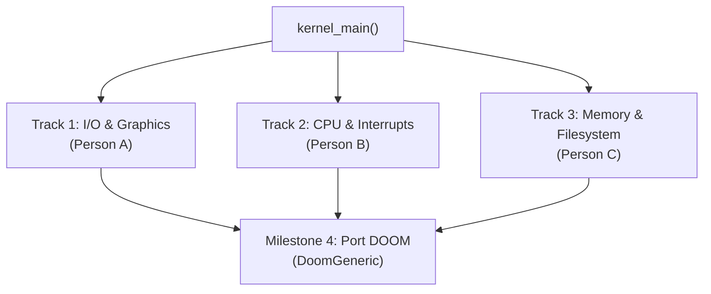

# x86-64 Kernel: 3-Person Team Engineering Roadmap

**Ultimate Goal**: Build a stable, modular 64-bit OS kernel in C that can run **DOOM** (*DoomGeneric*).

---

## 1. The Strategy: Zero Merge Conflicts

The primary failure mode in team kernel development is tight coupling (e.g. one developer changing `kernel.c` while waiting on another developer's memory allocator).

To prevent this:
1. **Interface-First Design**: All shared interfaces are defined in header files (`kernel/include/`) **before** implementation starts.
2. **Isolated Directory Trees**: Each teammate works in their own source files and directories.
3. **No Heavy Code in `kernel_main`**: `kernel_main` only acts as a conductor calling `subsystem_init()` functions in order.



---

## 2. Team Work Breakdown

### Track 1: Terminal, Graphics & Input (Person A)
*Directory*: `kernel/drivers/`  
*Header files*: `kernel/include/vga.h`, `kernel/include/kprintf.h`, `kernel/include/keyboard.h`, `kernel/include/fb.h`

* **Phase 1: Advanced Terminal & `kprintf`**
  * Expand VGA text driver with scrolling, backspace, and cursor control.
  * Implement `kprintf(const char *fmt, ...)` supporting `%s`, `%d`, `%x`, `%c`, `%p` without dynamic memory allocation (uses a stack buffer).
* **Phase 2: PS/2 Keyboard Driver**
  * Read raw scancodes from I/O port `0x60`.
  * Translate scancodes into ASCII characters; handle key-down and key-up states.
* **Phase 3: Graphical Framebuffer (VGA / VESA / GOP)**
  * Request a linear 32-bit framebuffer from GRUB using the Multiboot2 framebuffer tag.
  * Implement `fb_putpixel()`, `fb_clear()`, and back-buffer swapping (necessary for 35 FPS DOOM).

---

### Track 2: CPU Architecture, Interrupts & Timing (Person B)
*Directory*: `kernel/arch/`  
*Header files*: `kernel/include/gdt.h`, `kernel/include/idt.h`, `kernel/include/pic.h`, `kernel/include/timer.h`

* **Phase 1: Proper 64-bit GDT & TSS**
  * Set up complete Global Descriptor Table with Kernel Code, Kernel Data, User Code, User Data segments.
  * Configure Task State Segment (TSS) and Interrupt Stack Table (IST) for safe double fault handling.
* **Phase 2: IDT & CPU Exceptions**
  * Create Interrupt Descriptor Table (IDT) with 256 gates.
  * Write assembly interrupt stubs (`isr0` - `isr31`) to save/restore registers.
  * Implement crash handlers with register dumps for Page Fault (`#PF`), General Protection Fault (`#GP`), and Double Fault (`#DF`).
* **Phase 3: PIC Remap & PIT System Timer**
  * Remap 8259 PIC IRQs from hardware defaults to vectors `32-47`.
  * Configure 8254 Programmable Interval Timer (PIT) for 1000 Hz ticks.
  * Expose `uint64_t timer_get_ticks()` and `sleep_ms(uint32_t ms)` (directly powers DOOM's game clock).

---

### Track 3: Memory Management & Storage (Person C)
*Directory*: `kernel/mm/`, `kernel/fs/`  
*Header files*: `kernel/include/multiboot2.h`, `kernel/include/pmm.h`, `kernel/include/vmm.h`, `kernel/include/heap.h`, `kernel/include/tarfs.h`

* **Phase 1: Multiboot2 Parser & Physical Memory Manager (PMM)**
  * Parse GRUB Multiboot2 information structure (passed in `EBX`/`RDI` at boot).
  * Build a bitmap physical frame allocator (`pmm_alloc_frame()`, `pmm_free_frame()`) tracking 4 KiB RAM pages.
* **Phase 2: Virtual Memory (VMM) & Kernel Heap**
  * Manage 4-level paging (PML4, PDPT, PD, PT).
  * Build a kernel heap (`kmalloc()`, `kfree()`) using a linked-list or bucket allocator (DOOM requires dynamic allocation for textures, sounds, and map lumps).
* **Phase 3: Initrd / TarFS (WAD file storage)**
  * Configure GRUB to load `DOOM1.WAD` as a multiboot module.
  * Implement a simple read-only TarFS or memory-blob reader (`fs_read_file("DOOM1.WAD")`).

---

## 3. Directory Layout for Parallel Work

```text
x86-64-Kernel/
├── Makefile
├── linker.ld
├── CONTRIBUTING.md
├── README.md
├── ROADMAP.md                   # This roadmap
│
├── boot/                        # Shared bootstrap (done)
│   ├── header.asm
│   ├── boot.asm
│   └── grub.cfg
│
├── kernel/
│   ├── kernel.c                 # Clean orchestrator
│   │
│   ├── include/                 # CONTRACTS (agreed upon first)
│   │   ├── kprintf.h   (Person A)
│   │   ├── keyboard.h  (Person A)
│   │   ├── fb.h        (Person A)
│   │   ├── idt.h       (Person B)
│   │   ├── timer.h     (Person B)
│   │   ├── pmm.h       (Person C)
│   │   ├── heap.h      (Person C)
│   │   └── fs.h        (Person C)
│   │
│   ├── drivers/                 # Track 1 (Person A)
│   │   ├── vga.c
│   │   ├── kprintf.c
│   │   ├── keyboard.c
│   │   └── fb.c
│   │
│   ├── arch/                    # Track 2 (Person B)
│   │   ├── gdt.c / gdt_asm.asm
│   │   ├── idt.c / idt_asm.asm
│   │   ├── pic.c
│   │   └── timer.c
│   │
│   └── mm/                      # Track 3 (Person C)
│       ├── multiboot.c
│       ├── pmm.c
│       ├── vmm.c
│       ├── heap.c
│       └── tarfs.c
```

---

## 4. The DOOM Integration Phase (The Final Goal)

Once the three tracks are complete, porting DOOM uses **[DoomGeneric](https://github.com/ozkl/doomgeneric)**. It only requires implementing 5 glue functions:

| DoomGeneric Function | Supplied By | Subsystem |
| :--- | :--- | :--- |
| `DG_Init()` | Person A | Initializes video framebuffer |
| `DG_DrawFrame()` | Person A | Copies 320x200 pixel buffer to screen |
| `DG_SleepMs(ms)` | Person B | Uses PIT timer tick to pause |
| `DG_GetTicksMs()` | Person B | Returns `timer_get_ticks()` |
| `DG_GetKey(press, key)` | Person A | Reads from keyboard buffer |
| File I/O (`fopen`, `fread` for `DOOM1.WAD`) | Person C | TarFS module reader |
| Memory (`malloc`, `free`) | Person C | Kernel heap (`kmalloc`) |

---

## 5. Development Workflow & Git Rules

1. **Branch Names**:
   * Person A: `feat/drivers-vga`, `feat/keyboard`, `feat/framebuffer`
   * Person B: `feat/arch-gdt`, `feat/arch-idt`, `feat/timer`
   * Person C: `feat/mm-pmm`, `feat/mm-heap`, `feat/fs-tar`
2. **Review Policy**:
   * Minimum **1 approving review** from a teammate before merging into `main`.
3. **Daily Testing**:
   * Run `make run` in QEMU to ensure all merged branches build and boot cleanly without compiler warnings.
